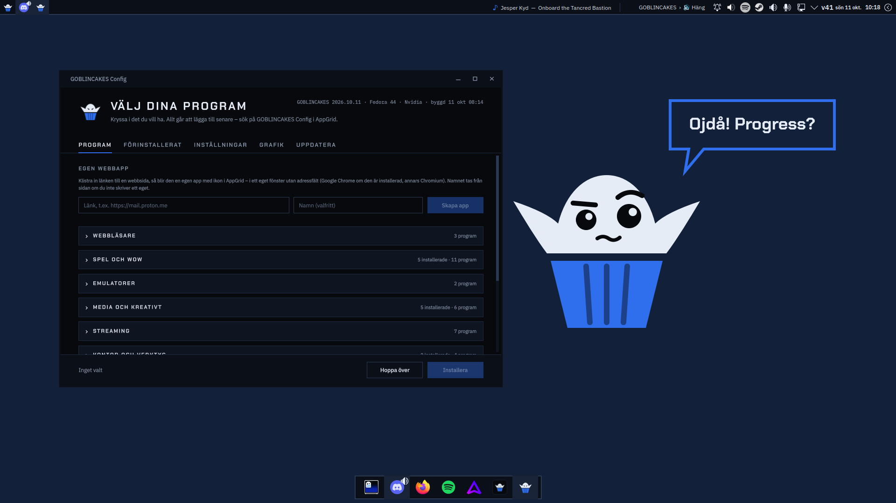
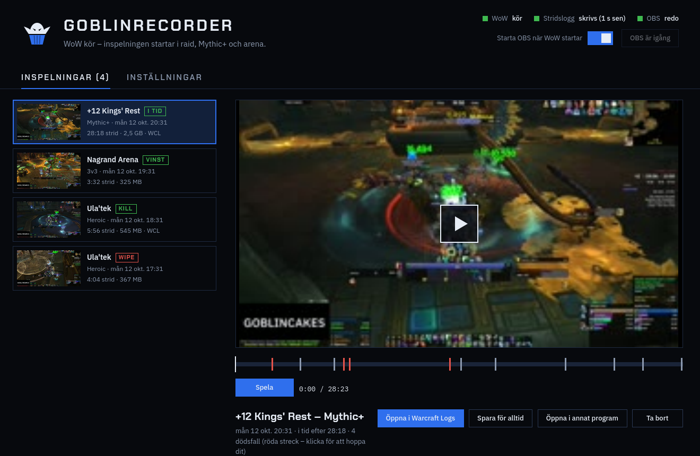
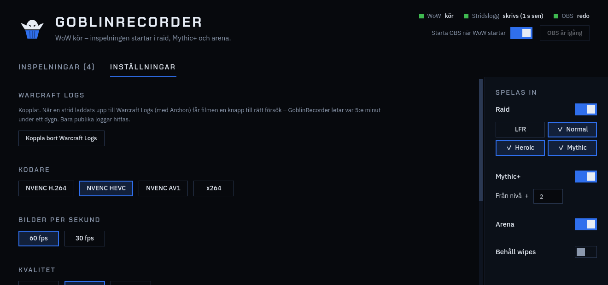
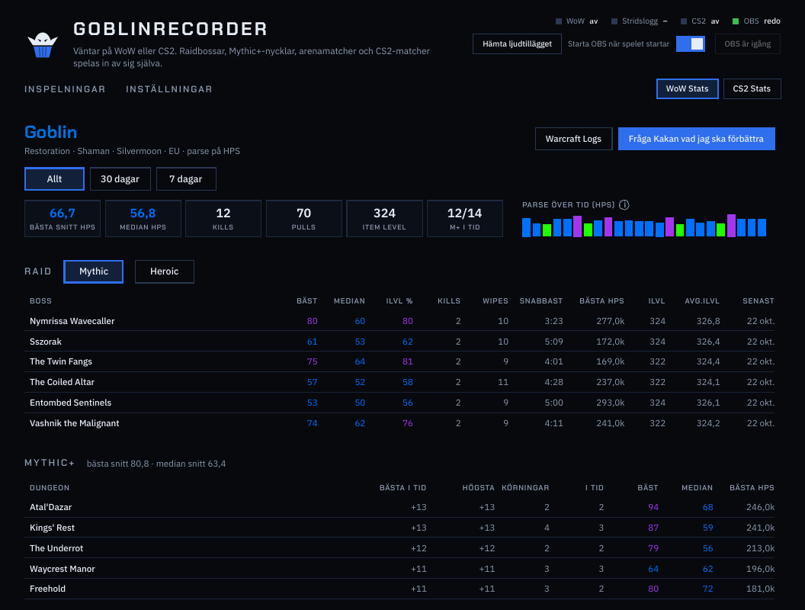
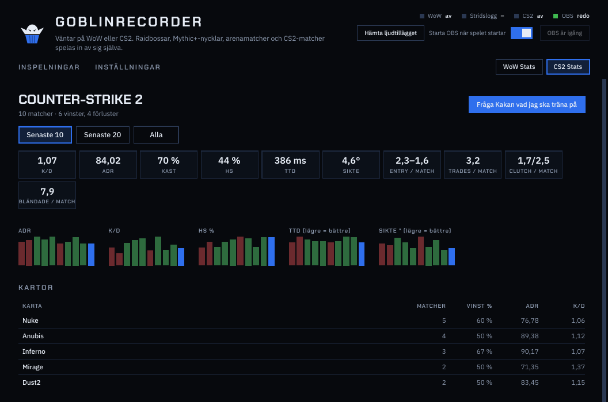
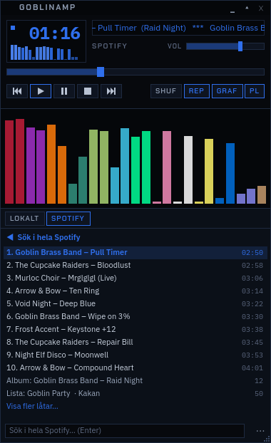
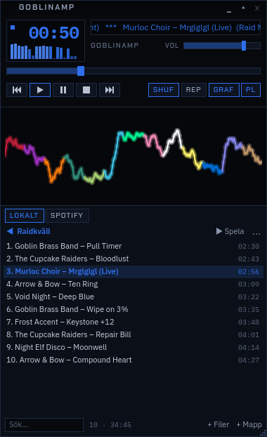
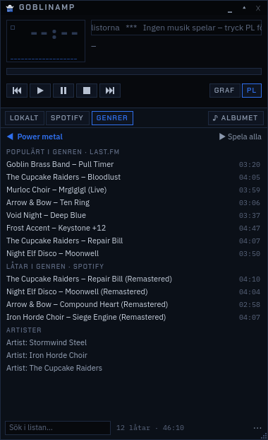
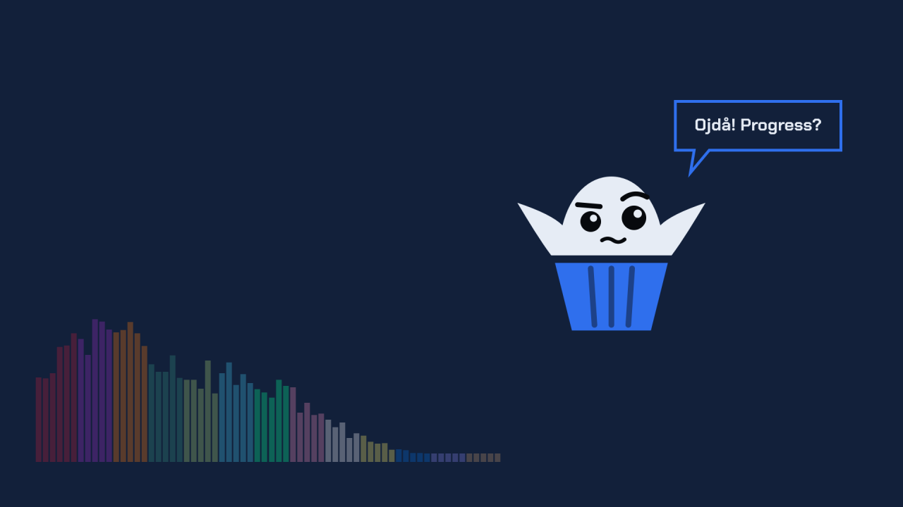

# GOBLINCAKES OS &nbsp; [](https://github.com/kaytho-git/goblincakes/actions/workflows/build.yml)

**En personlig Linux-distribution för spel, World of Warcraft och bågskytte – snygg, snabb och omöjlig att förstöra.**

GOBLINCAKES bygger på [Fedora Kinoite](https://fedoraproject.org/atomic-desktops/kinoite/) (KDE Plasma 6) via [Universal Blue](https://universal-blue.org/) och byggs automatiskt varje dag med [BlueBuild](https://blue-build.org/). Allt är platt, mörkt och fyrkantigt, med en goblin som maskot.



### ⬇ Ladda ner GOBLINCAKES USB

Programmet som gör ett installations-USB-minne åt dig (se [Installation](#med-goblincakes-usb-enklast)):

**[Windows](https://github.com/Kaytho-git/goblincakes/releases/download/usb-skaparen/GOBLINCAKES-USB-Windows.exe)** &nbsp;·&nbsp; **[Linux](https://github.com/Kaytho-git/goblincakes/releases/download/usb-skaparen/GOBLINCAKES-USB-Linux)** &nbsp;·&nbsp; [Alla filer](https://github.com/Kaytho-git/goblincakes/releases/tag/usb-skaparen)

## Målet

En dator som bara fungerar – för den som vill spela, raida och sköta bågskyttetävlingar utan att pilla med Linux:

- **Allt klart från start.** Rätt drivrutiner, rätt inställningar för spel och ett genomarbetat utseende redan vid första inloggningen.
- **Går inte att förstöra.** Systemet är *atomiskt*: varje uppdatering är en hel, testad version. Blir något fel väljer du förra versionen i startmenyn och är tillbaka på en minut.
- **Ett ställe för allt.** Program, inställningar, uppdateringar och grafikdrivrutiner sköts i ett eget fönster, *GOBLINCAKES Config* – ingen terminal behövs.
- **Håller sig uppdaterat.** En liten ruta i toppfältet visar när något nytt finns och vad det är; en knapp (eller `goblin update`) uppdaterar allt.
- **Egen installations-USB:** GOBLINCAKES USB gör ett USB-minne som installerar GOBLINCAKES på vilken dator som helst – precis som Windows eller SteamOS.

## Vad som finns i

### Utseende och skrivbord
- Eget tema i hela systemet: mörk palett, Chakra Petch och IBM Plex, raka hörn överallt.
- **Välj färg:** GOBLINCAKES blå eller någon av WoW:s 13 klassfärger – knappar, ramar, markeringar, inloggningen och de egna fönstren byter färg (Config → Inställningar → Utseende, eller `goblin färg`).
- **Webbläsarna** får GOBLINCAKES-tema: Firefox (med goblinen i fliklisten), Chrome, Brave och Chromium.
- Egen startskärm, inloggning, låsskärm och utloggning (*"Goodbye! See you next raid!"*). Vid inloggningen väljer du **Skrivbord** eller **TV-läge**.
- **Toppfältet:** appmenyn (AppGrid) mitt på skärmen, öppna program, *Spelas nu* och en ruta som visar när det finns uppdateringar.
- **Spelas nu** i toppfältet: vad Spotify eller musikspelaren spelar (klicka = pausa, scrolla = byt låt), vilken Discord-röstkanal du är i, vad Steam laddar ner eller vilka shaders som förbereds – och när Goblin AI tänker.
- **Dockan** gömmer sig när ett fönster täcker den.
- **Fönster i rutor:** rita egna layouter för skärmarna (Config → Fönster), dra program till rutorna och byt layout med **Meta+Ctrl+1–9** – gärna med ett eget skrivbord per layout. Nya fönster kan hamna i lediga rutor av sig själva, och drar du ett fönster till en upptagen ruta byter de plats.
- Ghostty som terminal (eller Konsole – välj i Config), med GOBLINCAKES-färger och en lista över `goblin`-kommandona i varje nytt fönster.
- Fedora-program som sällan behövs är dolda i appmenyn men finns kvar – och kan visas igen eller avinstalleras på riktigt (**Avinstallera program** i appmenyn).

### Spel
- **Steam** förinstallerat, plus Gamescope, GameMode och MangoHud (FPS-mätare). Windows-program utanför spelen: Bottles i GOBLINCAKES Config.
- **GE-Proton** hämtas och uppdateras automatiskt.
- **Starta spel från terminalen:** skriv spelets namn eller förkortning (t.ex. `wow`, `cs2`) så startas det via Steam. `goblin play dock cs2` fäster spelet i dockan med sin egen ikon – det startas fortfarande via Steam.
- **Spelmätning:** `goblin frames` visar hur jämnt spelet flöt – snitt-fps, 1 % low, ryck och frysningar med klockslag – och ger råd. En notis sammanfattar passet när du stänger spelet.
- **Handkontroller:** Xbox via dongel, USB och Bluetooth (xone, xpadneo), plus de vanliga PlayStation- och Switch-reglerna.
- **TV-läge:** Steam Big Picture i helskärm, som en Steam Deck – välj det vid inloggningen eller starta det från appmenyn.
- **Emulatorer:** RetroDECK (Super Nintendo, Mega Drive, N64, PlayStation, GameCube, Switch med flera) och Steam ROM Manager, som lägger in spelen i Steam och TV-läget.
- **Snabbare:** NTSYNC för Windows-spel och snabbare förberedelse av shaders i Steam.
- **Flera skärmar:** den snabbaste skärmen blir huvudskärm, och spelen öppnas där.
- **Spelläge** av sig självt när ett spel kör: GameMode, uppdateringar väntar tills du spelat klart och bakgrundstjänster som sökindexering vilar. OBS stängs när spelet är slut.
- **Laptops** med två grafikkort: spel startar på det kraftfulla kortet, skrivbordet på det snåla.
- **Äldre Nvidia-kort** (GTX 900- och 10-serien) får en egen variant med Nvidias legacy-drivrutin.

### World of Warcraft
- Battle.net via Lutris med GE-Proton, installerat så att butiken fungerar.
- **WowUp, Raider.IO och Archon** installeras och uppdateras automatiskt.
- Mapparna för `Logs` och `AddOns` – för alla WoW-versioner, var de än ligger – länkas till `~/Games/WoW`. WowUp och Raider.IO hittar WoW själva; `goblin wow` talar om vad du väljer i Archon.

### GoblinRecorder
Spelar in WoW och Counter-Strike 2 av sig själv med OBS – du behöver inte trycka på något:
- **Raid:** varje bossförsök blir en egen film, kill eller wipe, för de svårighetsgrader du väljer.
- **Mythic+:** hela nyckeln från start till slut, från den nivå du väljer.
- **Arena:** hela matchen (2v2, 3v3, Solo Shuffle, Skirmish) med vinst eller förlust.
- Bossar och dödsfall blir markeringar på tidslinjen – klicka för att hoppa dit – och filmen får en knapp till rätt försök på **Warcraft Logs**.
- Tre ljudspår (allt, bara WoW, Discord med din röst), brusreducering och en spärr mot andning i mikrofonen, och rutor som döljer chatten eller annat i filmerna.
- Inspelningen görs av grafikkortets egen videokrets (NVENC, eller VAAPI på AMD/Intel) – spelet märker inget. **Testa inspelningen** gör en 30-sekundersfilm så att du ser kvaliteten innan raiden.
- **Till YouTube:** klipp ut en del av filmen och ladda upp den direkt – titel, beskrivning med Warcraft Logs-länk och kapitel för varje boss skrivs åt dig.
- **Counter-Strike 2:** hela matchen spelas in via Valves Game State Integration och blir klipp – 2K till ACE och alla dina kills. När matchens demo laddats ner läses den: K/D, ADR, KAST, headshots, entries, trades, clutchar (vunna blir egna klipp), time to damage och siktets placering.
- **WoW Stats och CS2 Stats:** din egen statistik sammanställd på datorn ur det som spelats in. WoW: bästa och median-parse per boss och svårighetsgrad, kills, wipes (även de som inte spelades in, ur stridsloggen), snabbaste kill, item level och raidens snitt, Mythic+-nycklar och parse över tid. CS2: snittet för de senaste matcherna, varje karta och vapen och utvecklingen match för match. **Goblin AI** ger tips om vad du ska träna på.
- Ikon i systemfältet: röd prick när den spelar in.









### Discord
- Discords egen Linux-version (inte Flatpak), så att Discord ser vilket spel du spelar.
- **I GOBLINCAKES-stil:** Discord kan få GOBLINCAKES färger och raka hörn (Vencord, val i Config) – läggs in igen av sig självt när Discord uppdateras.
- Röstkanalen du är i syns i toppfältet. Okända kanaler: en notis frågar vad kanalen heter (eller `goblin discord namn Raid`).

### Bågskytte
- **[Ianseo](https://www.ianseo.net/)** (resultatprogrammet för bågskyttetävlingar) med ett klick: körs i en egen container, med automatisk backup var 30:e minut.
- **Tävlingsläge:** surfplattor och mobiler på samma nätverk når Ianseo.
- **Fjärråtkomst:** nå Ianseo via internet bakom ett lösenord (Cloudflare-tunnel, inga ändringar i routern). En ikon i systemfältet visar när Ianseo är nåbart utifrån.

### Musik: GoblinAmp och Spotify
- **GoblinAmp** – en liten spelare i Winamps anda: stor tid, rullande titel, staplar till musiken och knapparna du minns (Z X C V B). goblin graph kan visas inne i spelaren (**GRAF**), och spellistan (**PL**) dras högre i nederkanten.
  - **Egen musik:** Nu spelas, musikmappen och egna spellistor i Winamps format – dra in låtar och mappar från Dolphin, dra rader för att ändra ordningen, öppna gamla Winamp-listor.
  - **Spotify:** dina listor, Gillade låtar och kön; sök i hela Spotify, skapa egna listor, lägg till låtar med högerklick och ändra ordningen genom att dra. Artister visar alla album, populära låtar, singlar och liknande artister; ett helt album kan sparas som egen lista, och **♪ ALBUMET** öppnar albumet som spelas. Styr Spotify-appen, så ljudet och kvaliteten är som vanligt.
  - **GENRER:** välj en genre och få det populäraste i den (Last.fm) och Spotifys egna låtar och artister – eller musik som liknar det som spelas nu.
  - **Egen färg:** någon av klassfärgerna, eller samma som resten av GOBLINCAKES (högerklick på namnlisten).
- **Spotify (GOBLINCAKES)** – Spotify i GOBLINCAKES-stil och din färg, utan förslag och sidopaneler. Ljudet kommer från Spotify-appen, som ligger gömd i systemfältet, så kvaliteten blir som vanligt.

<p>
  
  
  
</p>

### goblin graph
Ljudstaplar till musiken i WoW:s klassfärger – ett fönster utan ram som ligger bland de andra fönstren, med bara staplarna synliga. Varje stapel i en klassfärg, eller allt i din klass färg (läses ur stridsloggen). Fyra vyer: staplar, våg, cirkel och explosion som smäller i takt. Lyssnar bara på musikprogram (Spotify, Quod Libet m.fl.), inte på spel eller film, och kan öppnas av sig själv när musiken börjar (`goblin graph auto on`). Ikonen i systemfältet byter vy och låser fönstret.



### GOBLINCAKES Config
Ett eget fönster som öppnas vid första inloggningen – och sedan med **Meta+C** eller från appmenyn:
- **Program** – kryssa i det du vill ha, i hopfällbara kategorier: webbläsare (Brave, Opera GX, Google Chrome – med reglaget *Huvudwebbläsare*), spel och WoW (Lutris, Battle.net, Discord, Heroic, ProtonUp-Qt, GPU Screen Recorder, WowUp, Raider.IO, Archon m.fl.), emulatorer, media (Spotify, OBS, GIMP, VLC, EasyEffects, Quod Libet), streaming (Netflix, Disney+, HBO Max, Prime Video, YouTube, SVT Play, TV4 Play), kontor (LibreOffice, Okular, Ark, FileZilla), Ianseo och system (Claude, VS Code, Claude Code, Pika Backup m.fl.).
  - **Egen webbapp:** klistra in en länk så blir sidan ett eget program med ikon.
  - **Starta vid inloggning:** reglage på installerade program.
- **Förinstallerat** – visa eller dölj systemets program i appmenyn.
- **Inställningar** – reglage med rubriker: prestandaläge, spelschemaläggare, MangoHud, spel på det kraftfulla grafikkortet, shader-cache, ljud med låg fördröjning, HDR, ingen musacceleration, automatiska uppdateringar, kalender med konton (Google, Outlook), Ianseo – plus färgval och en knapp som återställer GOBLINCAKES-utseendet.
- **Fönster** – layouter med rutor för skärmarna och vilka program som hamnar var; **Föreslå layout** ordnar dina huvudfönster åt dig.
- **Grafik** – byt mellan AMD/Intel- och Nvidia-drivrutiner med en knapp; hjälp med Secure Boot.
- **Uppdatera** – se vad som är nytt och uppdatera allt eller en del i taget (systemet, Flatpak-program, VS Code, Discord, WoW-tillägg, GE-Proton, firmware).

### Goblin AI
Fråga om datorn eller vad som helst – i ett eget fönster (**Meta+A**), i en snabbruta (**Meta+§**) eller i terminalen (`goblin ai`). Föreslagna kommandon körs bara när du säger ja, och AI:n kan ändra filer du bifogar.
- **Lokalt eller i molnet:** kör AI:n på din egen dator med Ollama (inget lämnar datorn; installeras med en knapp, förslag på modeller efter ditt grafikkort, stängs av medan du spelar) och/eller gratisnivåerna hos Gemini och OpenRouter – eller dina egna nycklar till Claude, OpenAI m.fl.
- **Söker på nätet** själv när du frågar om något nytt (gratis Tavily-nyckel).
- **Läser och skapar:** PDF:er, bilder och skärmbilder; ritar bilder (på datorn eller gratis via Cloudflare); sparar svar som PDF, Word eller bild.
- **Hjälper med datorn och spelet:** hittar fel i systemloggarna och föreslår lösningar steg för steg, läser WoW-tilläggens felmeddelanden och analyserar dina Warcraft Logs (dödsfall, cooldowns, förmågor) och dina CS2-matcher.
- **Projekt** med egna instruktioner, filer och modeller, ett **minne**, avatar och namn. ♥ under ett bra svar lär den att göra likadant nästa gång, 👎 att undvika det.
- **Egna knappar** ovanför rutan: ett tryck ger t.ex. det senaste om ditt lag (tabell och matcher hämtas direkt) eller sammanfattar en sida du länkar.
- **Ger inte upp:** är en modell överbelastad tar den nästa modell eller tjänst, och den lokala AI:n sist. Svar kan kopieras med formateringen kvar.
- **Lär dig koda:** kurser i Python, Lua, WoW-tillägg, HTML/CSS, JavaScript, PHP, SQL, Bash, Git, Godot och containrar – med uppgifter som kontrolleras automatiskt i en avskild övningsdator och en AI-lärare som ger ledtrådar i stället för svaret.

### Kommandon i terminalen
| Kommando | Gör |
|---|---|
| `goblin update` | Uppdaterar allt: systemet, program, WoW-tillägg, GE-Proton och firmware – och visar vad som är nytt |
| `goblin ai` | **Goblin AI** – fråga om datorn eller vad som helst (även **Meta+A**) |
| `goblin play` | Dina spel – skriv spelets namn eller förkortning direkt i terminalen (t.ex. `wow`, `cs2`) så startas det via Steam; `goblin play dock cs2` fäster det i dockan |
| `goblin amp` | **GoblinAmp** – musikspelaren (`goblin amp hjälp` visar hur Spotify-listorna kopplas in) |
| `goblin färg` | Byter GOBLINCAKES färg (`goblin färg mage`) |
| `goblin graph` | Ljudstaplar i WoW:s klassfärger till musiken (`goblin graph mage`, `goblin graph cirkel`) |
| `goblin screen` | Vilken skärm ett program öppnas på (`goblin screen add discord screen 2`) |
| `goblin tile` | Vilken ruta (KDE:s rutor, Meta+T) ett program öppnas i (`goblin tile add discord 2 1`) |
| `goblin frames` | Hur jämnt spelet flöt – snitt-fps, 1 % low och ryck, med råd |
| `goblin tv` | Startar TV-läget |
| `goblin wow` | Länkar alla WoW-versioner och uppdaterar WowUp |
| `goblin discord` | Namnger Discord-röstkanalen du är i (`goblin discord namn Raid`) |
| `goblin remove` | Avinstallerar Fedora-program (`goblin old` visar dem och hur du får tillbaka dem) |
| `goblin apps` | Visar dolda program igen |
| `goblin dock reset` | Återställer hela GOBLINCAKES-utseendet |
| `goblin nyheter` | Vad som är nytt i GOBLINCAKES |
| `goblin fast` | Systeminformation med GOBLINCAKES-loggan |
| `goblin help` | Visar alla kommandon |

Du får också en notis när GOBLINCAKES har gått över till en ny Fedora-version.

### Hårdvara
- Piper (gamingmöss), VIA (tangentbord) och ddcutil (skärmens ljusstyrka).
- Alla diskar syns och monteras automatiskt – även för Steam.
- **För egna projekt:** git och GitHub CLI (`gh`) är med från start; VS Code (Microsofts egen) och Claude Code installeras med ett klick i Config.

## Tre varianter

| Image | För |
|---|---|
| `ghcr.io/kaytho-git/goblincakes` | AMD- och Intel-grafik (och Nvidia med den öppna drivrutinen) |
| `ghcr.io/kaytho-git/goblincakes-nvidia` | Nvidia GTX 16-serien, RTX 20-serien och nyare, med Nvidias egna drivrutiner |
| `ghcr.io/kaytho-git/goblincakes-nvidia-legacy` | Äldre Nvidia: GTX 900- och 10-serien (Nvidias 580-drivrutin) |

Du behöver inte välja själv: GOBLINCAKES känner av grafikkortet och byter till rätt variant efter första starten, och **Config → Grafik** visar vilken du har.

## Installation

### Med GOBLINCAKES USB (enklast)

**GOBLINCAKES USB** är ett litet program för Windows och Linux som gör ett installations-USB-minne åt dig:

1. Ladda ner programmet från releasen [**usb-skaparen**](https://github.com/Kaytho-git/goblincakes/releases/tag/usb-skaparen):
   - Windows: `GOBLINCAKES-USB-Windows.exe` – ber om administratörsrättigheter. Windows kan varna eftersom programmet inte är signerat än: välj *Mer information → Kör ändå*.
   - Linux: `GOBLINCAKES-USB-Linux` – gör filen körbar (`chmod +x`) och starta den.
2. Välj ISO: **vanlig** (AMD/Intel) eller **Nvidia** (GTX 16xx/RTX 20xx eller nyare). Programmet ser vilket grafikkort datorn har och föreslår rätt – ska USB-minnet till en annan dator, välj efter den datorns kort. Fel val gör ingen skada: GOBLINCAKES rättar det efter första starten.
3. Sätt i ett USB-minne på minst 16 GB, välj det och tryck **Skapa USB-minne**. Allt på USB-minnet raderas.
4. Programmet hämtar ISO:n (ca 9,5 GB, Nvidia ca 11 GB) från releasen [**iso**](https://github.com/Kaytho-git/goblincakes/releases/tag/iso), kontrollerar varje del, skriver den till USB-minnet och läser sedan tillbaka allt för att se att det stämmer.
5. Starta datorn från USB-minnet (oftast F12, F11, F8 eller Esc vid start, i UEFI-läge). GOBLINCAKES startar direkt från USB-minnet – prova, och tryck sedan **Installera GOBLINCAKES**. Steam och TV-läget finns inte på USB-minnet men kommer med i installationen.

ISO:n går också att ladda ner för hand från releasen **iso** (i delar under 2 GB – se releasetexten) och skriva med t.ex. Rufus eller balenaEtcher.

### Från Fedora Kinoite

Har du redan Fedora Kinoite kan du byta till GOBLINCAKES direkt:

1. Byt till GOBLINCAKES (osignerad första gången, för att få signeringsnycklarna):
   ```bash
   rpm-ostree rebase ostree-unverified-registry:ghcr.io/kaytho-git/goblincakes:latest
   ```
   ```bash
   systemctl reboot
   ```
2. Byt till den signerade imagen:
   ```bash
   rpm-ostree rebase ostree-image-signed:docker://ghcr.io/kaytho-git/goblincakes:latest
   ```
   ```bash
   systemctl reboot
   ```
3. Logga in – GOBLINCAKES Config öppnas och hjälper dig med resten.

> [!NOTE]
> GOBLINCAKES är ett personligt projekt och utvecklas fortfarande. Det fungerar även i en virtuell maskin (VirtualBox: slå på 3D-acceleration och EFI).

## Uppdateringar och versioner

- GOBLINCAKES byggs **varje dag** och versionen är byggdatumet, t.ex. `GOBLINCAKES 2026.10.11`.
- Nya versioner hämtas automatiskt i bakgrunden och används vid nästa omstart (går att stänga av under **Config → Inställningar**). Rutan i toppfältet visar vad som väntar.
- Nya Fedora-versioner kommer automatiskt några veckor efter Fedoras släpp, när Universal Blue har gått över till dem.
- Den förra versionen finns alltid kvar i startmenyn.

## Verifiering

Imagerna är signerade med [Sigstore](https://www.sigstore.dev/)s [cosign](https://github.com/sigstore/cosign). Kontrollera signaturen med `cosign.pub` från det här repot:

```bash
cosign verify --key cosign.pub ghcr.io/kaytho-git/goblincakes
```

## Code signing policy

*(GOBLINCAKES USB – the Windows program `GOBLINCAKES-USB-Windows.exe`)*

- **What is signed:** only `GOBLINCAKES-USB-Windows.exe`, built by GitHub Actions ([`build-usb-creator.yml`](.github/workflows/build-usb-creator.yml)) from the source code in [`usb-skaparen/`](usb-skaparen/) of this repository. Nothing built outside that workflow is signed.
- **Team roles:** committer, reviewer and approver: [Kaytho-git](https://github.com/Kaytho-git). Every signing request is approved by hand. Accounts with write access to this repository use two-factor authentication.
- **Privacy policy:** GOBLINCAKES USB sends no information about you or your computer anywhere. The only network connections it makes are downloads of the installation ISO and its checksum list from this repository's GitHub Releases (github.com), which you start yourself.
- **License:** Apache 2.0 ([LICENSE](LICENSE)). Bundled components: Python, Qt/PySide6 (LGPL) and the fonts Chakra Petch, IBM Plex Sans and IBM Plex Mono (SIL Open Font License).

## Tack till

Byggt av **Kaytho och en fin kille**, ovanpå andras fina arbete: [Fedora](https://fedoraproject.org/), [Universal Blue](https://universal-blue.org/), [BlueBuild](https://blue-build.org/), [KDE](https://kde.org/), [Ghostty](https://ghostty.org/), [AppGrid](https://github.com/xarbit/appgrid) och Kvantum-temat KvFlat av Tsu Jan.
